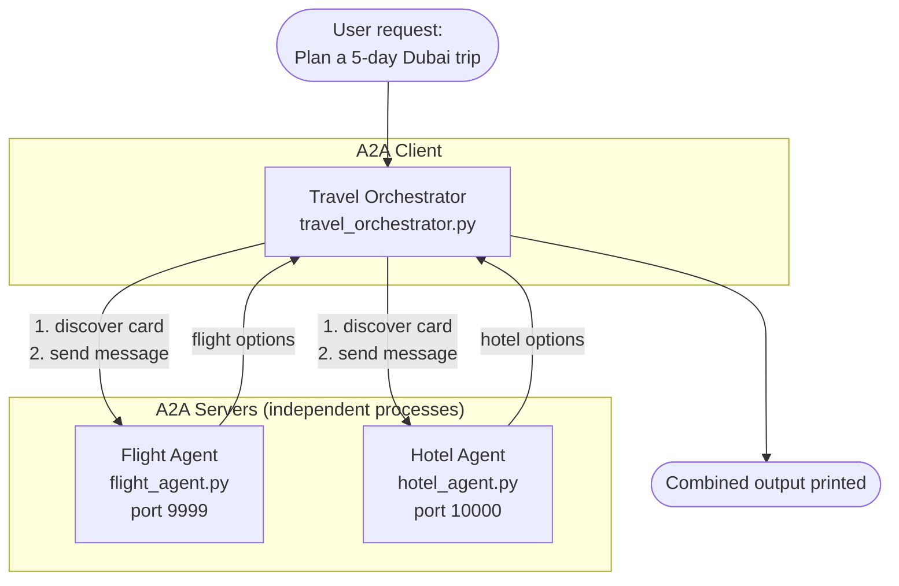
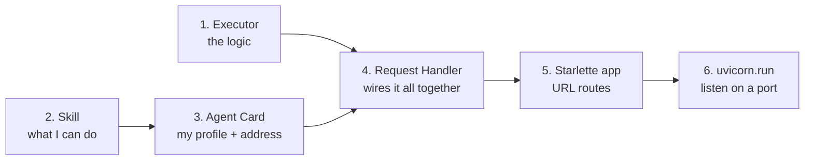
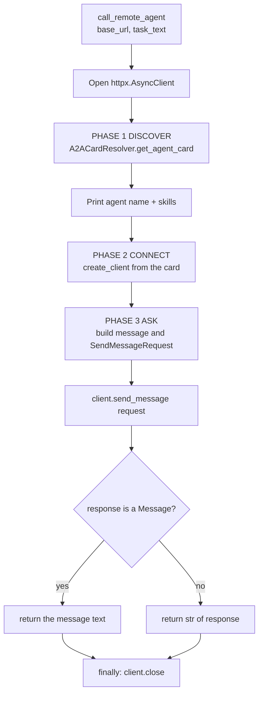
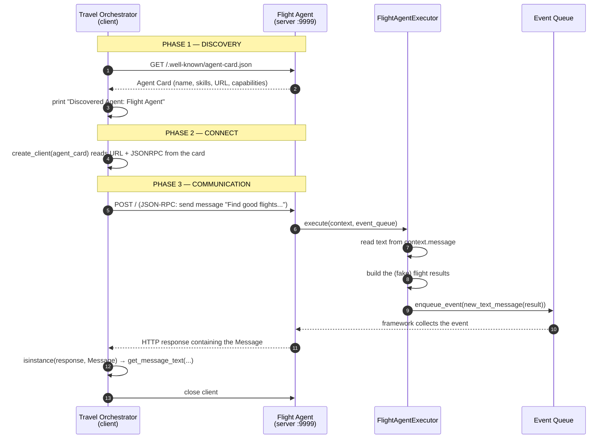

# A2A (Agent-to-Agent) Demo — A Beginner's Guide

This guide walks through the three Python files in this folder and teaches the core ideas of the **A2A protocol** along the way. No prior knowledge of A2A is assumed.

| File | Role | Listens on |
|------|------|-----------|
| [flight_agent.py](flight_agent.py) | A specialist agent that "finds flights" | `http://127.0.0.1:9999` |
| [hotel_agent.py](hotel_agent.py) | A specialist agent that "finds hotels" | `http://127.0.0.1:10000` |
| [travel_orchestrator.py](travel_orchestrator.py) | A manager (client) that discovers both agents and delegates work to them | — (it only makes calls) |

---

## Table of Contents

1. [What is A2A and why does it exist?](#1-what-is-a2a-and-why-does-it-exist)
2. [The big picture of this demo](#2-the-big-picture-of-this-demo)
3. [Key vocabulary](#3-key-vocabulary)
4. [How to run the demo](#4-how-to-run-the-demo)
5. [Expected output](#5-expected-output)
6. [Walkthrough: the agent server files](#6-walkthrough-the-agent-server-files-flight_agentpy--hotel_agentpy)
7. [Walkthrough: the orchestrator (client)](#7-walkthrough-the-orchestrator-travel_orchestratorpy)
8. [The full request lifecycle](#8-the-full-request-lifecycle-end-to-end)
9. [Python concepts used (cheat sheet)](#9-python-concepts-used-cheat-sheet)
10. [What is simplified in this demo?](#10-what-is-simplified-in-this-demo)
11. [Exercises to deepen your understanding](#11-exercises-to-deepen-your-understanding)
12. [Troubleshooting](#12-troubleshooting)

---

## 1. What is A2A and why does it exist?

Imagine you build an AI agent that plans trips. Another team built an agent that searches flights. A third company built one for hotels. They use different programming languages, different frameworks, and run on different servers.

**How do they talk to each other?**

Without a standard, every pair of agents needs a custom integration:

```
   WITHOUT A STANDARD                        WITH A2A

   Trip ──custom──► Flight                   Trip ──┐
   Trip ──custom──► Hotel                           │   (same protocol)
   Flight ─custom─► Hotel                    Flight ◄──► A2A ◄──► Hotel
   ... (n × n custom adapters)                      │
                                             Anyone ┘   (n adapters total)
```

**A2A (Agent2Agent) is an open protocol that standardizes how agents:**

1. **Discover** each other (*"Who are you and what can you do?"*)
2. **Communicate** (*"Please do this task"*)
3. **Return results** (*"Here's the answer"*)

It runs on top of normal web technology (HTTP + JSON), so any language can implement it.

### A2A vs MCP (a common question)

Since this demo lives in a folder about MCP and A2A, here is the difference:

```
┌──────────────────────────────────────────────────────────────────┐
│  MCP  (Model Context Protocol)                                   │
│  Agent  ◄────────►  TOOLS / DATA                                 │
│  "How does ONE agent use tools, files, databases?"               │
│  Think: an employee using a calculator or a filing cabinet.      │
├──────────────────────────────────────────────────────────────────┤
│  A2A  (Agent-to-Agent)                                           │
│  Agent  ◄────────►  Agent                                        │
│  "How do SEPARATE agents collaborate with each other?"           │
│  Think: one employee asking a colleague in another department.   │
└──────────────────────────────────────────────────────────────────┘
```

They are **complementary**, not competing. A real system often uses both: each agent uses MCP to reach its tools, and A2A to talk to other agents.

---

## 2. The big picture of this demo

We simulate a user asking: *"Plan a 5-day Dubai trip from Bangalore. I need a flight and a 4-star hotel."*

No single agent does everything. A **Travel Orchestrator** splits the job and delegates to two **specialists**.

### Architecture (line diagram)

```
                         ┌─────────────────────────────┐
                         │      USER REQUEST           │
                         │ "Plan a 5-day Dubai trip…"  │
                         └──────────────┬──────────────┘
                                        │
                                        ▼
                    ┌───────────────────────────────────────┐
                    │        TRAVEL ORCHESTRATOR            │
                    │        (travel_orchestrator.py)       │
                    │        A2A CLIENT                     │
                    └───────┬───────────────────────┬───────┘
                            │                       │
         A2A over HTTP      │                       │      A2A over HTTP
        (JSON-RPC)          │                       │      (JSON-RPC)
                            ▼                       ▼
            ┌──────────────────────┐     ┌──────────────────────┐
            │     FLIGHT AGENT     │     │     HOTEL AGENT      │
            │   (flight_agent.py)  │     │   (hotel_agent.py)   │
            │   A2A SERVER         │     │   A2A SERVER         │
            │   127.0.0.1:9999     │     │   127.0.0.1:10000    │
            └──────────────────────┘     └──────────────────────┘
```

### Architecture (Mermaid)



Key idea: **the three programs are completely separate processes.** They share no variables and no code. The *only* thing connecting them is HTTP messages that follow the A2A protocol.

---

## 3. Key vocabulary

| Term | Plain-English meaning | In this demo |
|------|----------------------|--------------|
| **A2A Server** (a.k.a. remote agent) | A program that *offers* skills and answers requests | Flight Agent, Hotel Agent |
| **A2A Client** | A program that *calls* remote agents | Travel Orchestrator |
| **Agent Card** | A public JSON "business card/profile": name, description, skills, address, supported features | `AgentCard(...)` in each agent file |
| **Skill** | One specific thing an agent can do | `search_flights`, `find_hotels` |
| **Agent Discovery** | A client downloading an agent's card to learn about it | `resolver.get_agent_card()` |
| **Executor** | The class holding the agent's actual logic ("brain") | `FlightAgentExecutor`, `HotelAgentExecutor` |
| **Message** | A unit of communication (a role + text/parts) | `new_text_message(...)` |
| **Event Queue** | A "mailbox" the agent drops replies into | `event_queue.enqueue_event(...)` |
| **Task Store** | Where the server remembers tasks | `InMemoryTaskStore()` |
| **Request Handler** | Framework glue: receives requests, runs the executor, returns responses | `DefaultRequestHandler` |
| **JSON-RPC** | A simple "call a remote function using JSON over HTTP" format | `protocol_binding="JSONRPC"` |
| **Orchestrator** | A manager agent that delegates to other agents | `travel_orchestrator.py` |
| **Streaming** | Receiving a reply in live chunks rather than all at once | Disabled (`streaming=False`) |

---

## 4. How to run the demo

You need **three terminals**. Start the two agents first, because the orchestrator needs them to be running.

```bash
# Terminal 1 — start the Flight Agent (port 9999)
python flight_agent.py

# Terminal 2 — start the Hotel Agent (port 10000)
python hotel_agent.py

# Terminal 3 — run the orchestrator
python travel_orchestrator.py
```

```
 Terminal 1            Terminal 2            Terminal 3
┌────────────┐        ┌────────────┐        ┌──────────────────┐
│ flight     │        │ hotel      │        │ orchestrator     │
│ agent      │        │ agent      │        │                  │
│ (stays     │        │ (stays     │        │ (runs, prints    │
│  running)  │        │  running)  │        │  results, exits) │
└────────────┘        └────────────┘        └──────────────────┘
   start 1st             start 2nd             start LAST
```

**Prerequisites:** Python 3.10+ and the packages `a2a-sdk`, `uvicorn`, `starlette`, and `httpx`. Install them in your virtual environment (for example `pip install a2a-sdk uvicorn httpx`; Starlette is installed along with the others).

> The agents are long-running servers: they keep running until you stop them with `Ctrl+C`. The orchestrator is a one-shot script: it runs once and exits.

---

## 5. Expected output

**Terminals 1 and 2** (the agents) will show uvicorn logs such as `Uvicorn running on http://127.0.0.1:9999`, followed by one log line per incoming HTTP request.

**Terminal 3** (the orchestrator) prints roughly:

```
=================================================================
TRAVEL ORCHESTRATOR AGENT
=================================================================

USER REQUEST:
Plan a 5-day Dubai trip from Bangalore. I need a flight and a 4-star hotel.

Discovered Agent: Flight Agent
Skills:
- Search Flights

Discovered Agent: Hotel Agent
Skills:
- Find Hotels

=================================================================
FLIGHT AGENT RESPONSE
=================================================================
Flight Agent result:
Bangalore -> Dubai
1. Emirates EK569 | Non-stop | ₹28,000
2. Air India AI995 | 1 stop | ₹24,500

Received task: Find good flights from Bangalore to Dubai.

=================================================================
HOTEL AGENT RESPONSE
=================================================================
Hotel Agent result:
Dubai, 5 nights
1. Business Bay Hotel | 4-star | ₹9,500/night
2. Downtown Executive Hotel | 4-star | ₹11,000/night

Received task: Find a 4-star hotel in Dubai for 5 nights.

=================================================================
FINAL ORCHESTRATED RESULT
=================================================================
Travel Orchestrator delegated work to two independent A2A agents and collected their responses.
```

Notice the line `Received task: ...` at the end of each agent response. The agent *echoes back* what it received, which proves the message really travelled over the network.

---

## 6. Walkthrough: the agent server files (`flight_agent.py` / `hotel_agent.py`)

The two files are **structurally identical**. Only names, data, and the port differ:

| Detail | Flight Agent | Hotel Agent |
|--------|--------------|-------------|
| Executor class | `FlightAgentExecutor` | `HotelAgentExecutor` |
| Skill id | `search_flights` | `find_hotels` |
| Card name | "Flight Agent" | "Hotel Agent" |
| Port / URL | `9999` | `10000` |
| Fake data | flights | hotels |

So we explain one (the flight agent), and everything applies to the other.

### 6.1 The assembly line

Each agent file builds the server in six steps. Each step feeds the next:

```
 STEP 1            STEP 2          STEP 3             STEP 4
┌─────────┐      ┌─────────┐     ┌────────────┐     ┌───────────────────┐
│Executor │      │ Skill   │────►│ Agent Card │────►│ Request Handler   │
│ (logic) │      │ (what I │     │ (my profile│     │ (executor + task  │
│         │      │  can do)│     │  + address)│     │  store + card)    │
└────┬────┘      └─────────┘     └────────────┘     └─────────┬─────────┘
     │                                                        │
     └────────────────────────────────────────────────────────┤
                                                              ▼
                                      STEP 5                        STEP 6
                                 ┌──────────────┐             ┌────────────────┐
                                 │ Starlette app│────────────►│ uvicorn.run()  │
                                 │ + routes     │             │ opens the port │
                                 └──────────────┘             └────────────────┘
```



### 6.2 Step 1 — The Executor (the agent's brain)

```python
class FlightAgentExecutor(AgentExecutor):
    async def execute(self, context: RequestContext, event_queue: EventQueue) -> None:
        query = get_message_text(context.message) if context.message else ""

        result = (
            "Flight Agent result:\n"
            ...
            f"\nReceived task: {query}"
        )

        await event_queue.enqueue_event(new_text_message(result))
```

What happens, line by line:

1. `FlightAgentExecutor(AgentExecutor)` — we **inherit** from the SDK's base class. Inheritance means "my class gets the standard behaviour, and I fill in the specific parts."
2. `execute()` is **called automatically by the framework** each time a message arrives. You never call it yourself.
3. `context` carries the incoming request. `context.message` is what the caller said.
4. `get_message_text(...)` extracts the plain text. The `if context.message else ""` is a safety check: if there is no message, use an empty string instead of crashing.
5. We build a fixed (fake) answer. In the real world this is where you would call an airline API, query a database, or ask an LLM.
6. `new_text_message(result)` wraps the text in a proper A2A message.
7. `event_queue.enqueue_event(...)` puts the message in the **mailbox**. The framework picks it up and sends it to the caller over HTTP.

```
 incoming          ┌───────────── execute() ──────────────┐        outgoing
 request  ───────► │ 1. read text from context.message    │
                   │ 2. build a result string             │
                   │ 3. wrap it: new_text_message(result) │ ─────► event_queue ─────► reply
                   └──────────────────────────────────────┘        (the mailbox)
```

**`cancel()`** is part of the required interface: it is called when a caller wants to stop a long-running task. Our agent answers instantly so there is nothing to stop. It simply raises `NotImplementedError`, i.e. "cancel is not supported."

> **Why `async`/`await`?** Servers handle many requests at once. `await` says "I'm waiting on something slow (like the network); let other work run meanwhile." See [section 9](#9-python-concepts-used-cheat-sheet).

### 6.3 Step 2 — The Skill (what can I do?)

```python
skill = AgentSkill(
    id="search_flights",
    name="Search Flights",
    description="Searches flight options between cities.",
    input_modes=["text/plain"],
    output_modes=["text/plain"],
    tags=["travel", "flight"],
    examples=["Find flights from Bangalore to Dubai"],
)
```

| Field | Purpose |
|-------|---------|
| `id` | Unique machine-friendly identifier |
| `name` | Human-friendly label (the orchestrator prints this) |
| `description` | What the skill does; an LLM-based orchestrator could read this to decide *whether to call this agent* |
| `input_modes` / `output_modes` | Content types accepted/produced (`text/plain` = ordinary text). Others might be `application/json` or images |
| `tags` | Keywords for search/discovery |
| `examples` | Sample requests that show callers how to ask |

A skill is **advertising**, not code. The code that actually runs lives in the executor.

### 6.4 Step 3 — The Agent Card (the business card)

```python
agent_card = AgentCard(
    name="Flight Agent",
    description="Specialized agent for searching flights.",
    version="1.0.0",
    default_input_modes=["text/plain"],
    default_output_modes=["text/plain"],
    capabilities=AgentCapabilities(streaming=False, extended_agent_card=False),
    supported_interfaces=[
        AgentInterface(
            protocol_binding="JSONRPC",
            url="http://127.0.0.1:9999",
            protocol_version="1.0",
        )
    ],
    skills=[skill],
)
```

The card is what makes **discovery** possible. A client downloads it *before* sending any task, and learns:

```
┌──────────────────────── AGENT CARD ─────────────────────────┐
│ WHO am I?        name, description, version                 │
│ WHAT can I do?   skills = [ Search Flights ]                │
│ WHAT formats?    default_input_modes / default_output_modes │
│ WHAT features?   capabilities (streaming? extended card?)   │
│ HOW to reach me? supported_interfaces:                      │
│                    protocol = JSONRPC                       │
│                    url      = http://127.0.0.1:9999         │
└─────────────────────────────────────────────────────────────┘
```

Important details:

* **`capabilities.streaming=False`** — we send one complete reply. (A streaming agent would send progress in pieces — useful for long LLM answers.)
* **`extended_agent_card=False`** — we don't offer a second, more detailed card (some agents give extra details only to authenticated callers).
* **`supported_interfaces`** — tells clients the transport. `JSONRPC` means "send JSON-RPC requests over HTTP to this URL."
* **The URL port must match the port in `uvicorn.run(...)`** at the bottom of the file. If they don't match, the client will read the card and then try to call the wrong address.

A card is just JSON. Conceptually it looks like this:

```json
{
  "name": "Flight Agent",
  "description": "Specialized agent for searching flights.",
  "version": "1.0.0",
  "capabilities": { "streaming": false },
  "supportedInterfaces": [
    { "protocolBinding": "JSONRPC", "url": "http://127.0.0.1:9999", "protocolVersion": "1.0" }
  ],
  "skills": [ { "id": "search_flights", "name": "Search Flights", "...": "..." } ]
}
```

(The exact field spelling on the wire is decided by the SDK; the above is illustrative.)

### 6.5 Step 4 — The Request Handler (the traffic controller)

```python
request_handler = DefaultRequestHandler(
    agent_executor=FlightAgentExecutor(),
    task_store=InMemoryTaskStore(),
    agent_card=agent_card,
)
```

It connects the three ingredients:

```
                  ┌───────────────────────────────┐
 HTTP request ──► │     DefaultRequestHandler     │ ──► HTTP response
                  │                               │
                  │  uses ► FlightAgentExecutor   │  (does the work)
                  │  uses ► InMemoryTaskStore     │  (remembers tasks)
                  │  uses ► agent_card            │  (knows who it is)
                  └───────────────────────────────┘
```

* `InMemoryTaskStore` keeps task data **in RAM**. Stop the server and it is gone. Production systems would use a database.

### 6.6 Step 5 — The web app and its routes

```python
app = Starlette(
    routes=[
        *create_agent_card_routes(agent_card),
        *create_jsonrpc_routes(request_handler, "/"),
    ]
)
```

A **route** maps a URL to code. We register two groups:

```
 http://127.0.0.1:9999
        │
        ├── /.well-known/agent-card.json   ──► returns the Agent Card   (DISCOVERY)
        │        (created by create_agent_card_routes)
        │
        └── /                              ──► accepts JSON-RPC messages (COMMUNICATION)
                 (created by create_jsonrpc_routes)
```

* `/.well-known/agent-card.json` is the **standard location** for agent cards, so clients always know where to look. (You can check it yourself — see [Exercises](#11-exercises-to-deepen-your-understanding).)
* The `*` in front of each call **unpacks** the returned list so both lists merge into one flat list.

**Starlette** is a small Python web framework. **uvicorn** is the server that runs it.

### 6.7 Step 6 — Start the server

```python
if __name__ == "__main__":
    uvicorn.run(app, host="127.0.0.1", port=9999)
```

* `if __name__ == "__main__":` means "only do this when I'm run directly (`python flight_agent.py`), not when I'm imported by another file."
* `host="127.0.0.1"` is **localhost**: only your own computer can reach it. Great and safe for demos.
* `port=9999` is like an apartment number on your computer: the hotel agent uses `10000`, so the two don't collide.

---

## 7. Walkthrough: the orchestrator (`travel_orchestrator.py`)

### 7.1 Structure

```
travel_orchestrator.py
│
├── call_remote_agent(base_url, task_text)   ← reusable helper: talk to ONE agent
│        1. DISCOVER   download the agent card
│        2. CONNECT    build an A2A client from the card
│        3. ASK        send the message, read the reply
│
└── main()                                    ← the "plan"
         - print the user request
         - call_remote_agent(flight URL, flight task)
         - call_remote_agent(hotel URL,  hotel task)
         - print everything
```

The helper function is written **once** and used **twice** (flight and hotel) — a good habit that also shows A2A's strength: *the same client code can talk to any A2A agent.*

### 7.2 `call_remote_agent` in three phases



**Phase 1 — Discover**

```python
resolver = A2ACardResolver(httpx_client=httpx_client, base_url=base_url)
agent_card = await resolver.get_agent_card()
```

The resolver takes a base URL such as `http://127.0.0.1:9999` and fetches the card from the standard `/.well-known/agent-card.json` location. We then print the agent's name and skills so you can *see* discovery working.

**Phase 2 — Connect**

```python
client = await create_client(
    agent=agent_card,
    client_config=ClientConfig(streaming=False),
)
```

We hand the whole card to `create_client`. The card already says "speak JSON-RPC at this URL", so **we never hard-code the protocol details** — the card drives the connection. `streaming=False` means "wait for one full reply."

**Phase 3 — Ask**

```python
message = new_text_message(task_text, role=Role.ROLE_USER)
request = SendMessageRequest(message=message)

async for response in client.send_message(request):
    if isinstance(response, Message):
        return get_message_text(response)
    return str(response)
```

* `Role.ROLE_USER` labels the sender as the "user" side of the conversation.
* `SendMessageRequest` is the envelope that carries the message.
* `send_message` is an **async generator**: it can yield several responses (useful for streaming). We loop with `async for`, but return on the **first** response because our demo agents reply once.
* `isinstance(response, Message)` — the agent may reply with a simple `Message` (ours do) *or* a richer `Task` object (used for long-running work). For a `Message` we extract the text; otherwise we fall back to `str(response)`.

**Cleanup — `try / finally`**

```python
try:
    ...
finally:
    await client.close()
```

`finally` **always** runs, even if an error occurs or we `return` early, so the client's network resources are released. The `async with httpx.AsyncClient()` at the top does the same job for the HTTP session.

The last line, `return "No response received."`, is a safety net that is only reached if the agent never sent anything back.

### 7.3 `main()` — the orchestration plan

```python
flight_result = await call_remote_agent("http://127.0.0.1:9999",  "Find good flights from Bangalore to Dubai.")
hotel_result  = await call_remote_agent("http://127.0.0.1:10000", "Find a 4-star hotel in Dubai for 5 nights.")
```

The user asked for *one big thing*; the orchestrator **breaks it into two smaller tasks** and sends each to the right specialist:

```
  "Plan a 5-day Dubai trip from Bangalore.
   I need a flight and a 4-star hotel."
                    │
          ┌─────────┴──────────┐   ← decomposition (hard-coded here)
          ▼                    ▼
 "Find good flights     "Find a 4-star hotel
  from Bangalore         in Dubai for
  to Dubai."             5 nights."
          │                    │
          ▼                    ▼
    Flight Agent          Hotel Agent
```

> In this demo the split is **hard-coded by the programmer**. In a real orchestrator, an LLM would read the request, look at the agent cards' skills/descriptions, and **decide** which agents to call and what to ask each one. That is the natural next step (see Exercises).

Also note the two calls run **one after the other** (sequentially). They are independent, so they could be run at the same time — see Exercises.

---

## 8. The full request lifecycle (end to end)

This is the complete conversation for **one** remote agent (the flight agent). The hotel call is identical but on port 10000.



The same flow as an ASCII timeline:

```
 ORCHESTRATOR                                           FLIGHT AGENT
      │                                                      │
      │  (1) GET /.well-known/agent-card.json                │
      │ ───────────────────────────────────────────────────► │
      │  (2) Agent Card (JSON)                               │
      │ ◄─────────────────────────────────────────────────── │
      │                                                      │
      │  (3) "I now know your URL & protocol."               │
      │      create_client(...)                              │
      │                                                      │
      │  (4) POST /  { send message: "Find good flights…" }  │
      │ ───────────────────────────────────────────────────► │
      │                                          execute() runs
      │                                          builds result text
      │                                          puts it in event_queue
      │  (5) { Message: "Flight Agent result: …" }           │
      │ ◄─────────────────────────────────────────────────── │
      │                                                      │
      │  (6) print the text; close the client                │
      ▼                                                      ▼
```

### What does the wire traffic look like?

JSON-RPC wraps a function call in JSON: *"call method X with these params, and here's an id so I can match the reply."* Conceptually (field names are illustrative; the SDK builds the real thing for you):

```json
// Request  (orchestrator ──► agent)
{
  "jsonrpc": "2.0",
  "id": "abc-123",
  "method": "SendMessage",
  "params": {
    "message": {
      "role": "ROLE_USER",
      "parts": [ { "text": "Find good flights from Bangalore to Dubai." } ]
    }
  }
}

// Response (agent ──► orchestrator)
{
  "jsonrpc": "2.0",
  "id": "abc-123",
  "result": {
    "message": {
      "role": "ROLE_AGENT",
      "parts": [ { "text": "Flight Agent result:\nBangalore -> Dubai\n..." } ]
    }
  }
}
```

One reason the SDK is helpful: you never write this JSON by hand.

---

## 9. Python concepts used (cheat sheet)

| Concept | Where | Meaning |
|---------|-------|---------|
| `async def` / `await` | `execute`, `call_remote_agent`, `main` | A function that can *pause* while waiting for slow I/O (network) so the program isn't frozen. `await` marks the pause point. |
| `asyncio.run(main())` | bottom of orchestrator | Starts the async "event loop" that actually runs async functions. You can't just call `main()` — that would only create an un-run coroutine. |
| `async with` | `httpx.AsyncClient()` | Like `with`, but for async resources. Auto-cleans up when the block ends. |
| `async for` | `client.send_message(...)` | Loop over results that arrive over time. |
| `try / finally` | orchestrator | `finally` code runs no matter what — ideal for cleanup. |
| Class inheritance | `class FlightAgentExecutor(AgentExecutor)` | Reuse a base class and fill in the required methods. |
| `if __name__ == "__main__":` | bottom of every file | Run this block only when the file is executed directly, not imported. |
| `*list` unpacking | `routes=[*a, *b]` | Spread the items of a list into another list. |
| Adjacent string literals | `result = ("a\n" "b\n")` | Strings next to each other (inside parentheses) are joined into one. |
| f-strings | `f"...{query}"` | Insert variables into a string. |
| `isinstance(x, T)` | orchestrator | Check what type an object is. |
| Type hints | `-> str`, `query: str` | Documentation for humans/tools; Python doesn't enforce them at runtime. |

---

## 10. What is simplified in this demo?

This demo is intentionally minimal so the **core protocol flow** is easy to see. A production system would differ:

| This demo | Real-world |
|-----------|-----------|
| Agent replies are hard-coded fake data | Agents call real APIs, databases, or LLMs |
| Orchestrator hard-codes who to call and what to ask | An LLM decides which agents to call, based on their cards |
| Final result is a fixed sentence | Orchestrator merges results into one itinerary |
| Calls run one after another | Independent calls run in parallel |
| Replies are single `Message`s | Long jobs use a `Task` with states (working, completed, failed…) and updates |
| `streaming=False` | Streaming for live partial output |
| `cancel()` unsupported | Real cancellation |
| `InMemoryTaskStore` (lost on restart) | Persistent database store |
| Plain `http://127.0.0.1` with no authentication | HTTPS, authentication (API keys / OAuth), authorization |
| Everything on one computer | Agents on different servers, clouds, even companies |
| Errors are not handled | Retries, timeouts, and error handling |

---

## 11. Exercises to deepen your understanding

**Beginner**

1. **Look at the card yourself.** With the flight agent running, open `http://127.0.0.1:9999/.well-known/agent-card.json` in a browser (or `curl` it). Compare the JSON with the `AgentCard(...)` in the code.
2. **Change the data.** Edit the fake flights in `flight_agent.py`, restart that agent, and re-run the orchestrator. Watch the output change.
3. **Change the question.** Edit the task text in `main()` and see the `Received task:` echo change.
4. **Break it on purpose.** Stop the hotel agent and run the orchestrator. Read the error: it shows what happens when a remote agent is unreachable.

**Intermediate**

5. **Add a third agent**, for example a Weather Agent on port `10001`. Copy `hotel_agent.py`, change the names, skill, data, *both* port numbers (the card URL and `uvicorn.run`), and add a third `call_remote_agent(...)` in `main()`.
6. **Make it parallel.** Use `asyncio.gather(...)` to run the flight and hotel calls at the same time:
   ```python
   flight_result, hotel_result = await asyncio.gather(
       call_remote_agent("http://127.0.0.1:9999", "..."),
       call_remote_agent("http://127.0.0.1:10000", "..."),
   )
   ```
7. **Print the whole card.** In the orchestrator, `print(agent_card)` after discovery and study every field.

**Advanced**

8. **Use the agent's input.** Make the flight agent parse the `query` (e.g. detect the cities) and return different results.
9. **Add an LLM.** Replace the fake `result` with a call to an LLM so the agent really generates answers.
10. **LLM-driven orchestrator.** Give the orchestrator an LLM and the list of agent cards; let it choose which agents to call and what to ask, then merge the replies into one itinerary.
11. **Try streaming.** Set `streaming=True` in the card and client config, and make the agent send several events instead of one.

---

## 12. Troubleshooting

| Symptom | Likely cause | Fix |
|---------|--------------|-----|
| `Connection refused` / `All connection attempts failed` | An agent isn't running | Start both agents *before* the orchestrator |
| `Address already in use` when starting an agent | Port 9999 or 10000 is taken (maybe an old copy of the agent) | Stop the old process (`Ctrl+C`) or pick another port, changing **both** the card URL and `uvicorn.run` |
| Orchestrator discovers the agent but the call fails | Card `url` and the actual server port don't match | Make them identical |
| `ModuleNotFoundError: a2a` | SDK not installed in the active environment | Activate your virtual environment and `pip install a2a-sdk` |
| Import errors for names like `a2a.helpers` or `create_client` | The `a2a-sdk` version differs from the one this demo was written for (the SDK's API has changed between versions) | Install the version the course specifies, or check the SDK docs for the renamed items |
| Edits to an agent don't show up | The server is still running the old code | Stop it with `Ctrl+C` and start it again |

---

### One-paragraph summary

> Each **agent** is a small web server that publishes an **Agent Card** (its profile and address) and runs an **Executor** (its logic) whenever a message arrives. The **orchestrator** is a client that **discovers** each agent by downloading its card, **connects** using the information on that card, **sends a message**, and **reads the reply**. Because every agent follows the same A2A protocol, the orchestrator can work with any of them without custom code — which is the whole point of A2A.
